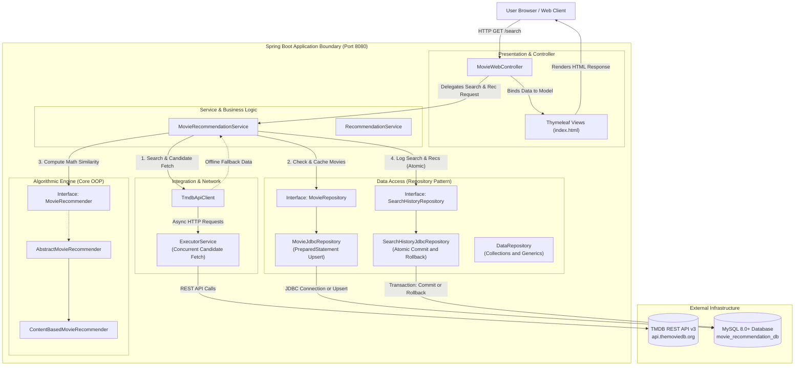
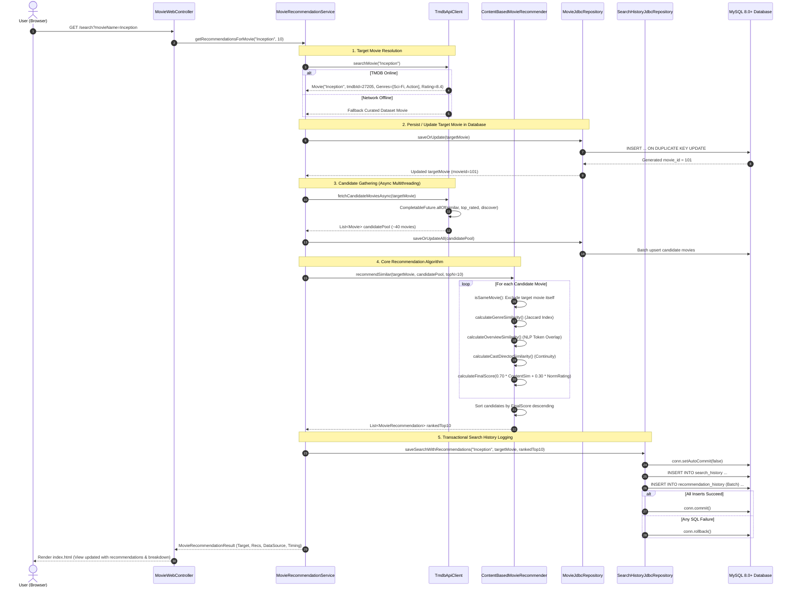
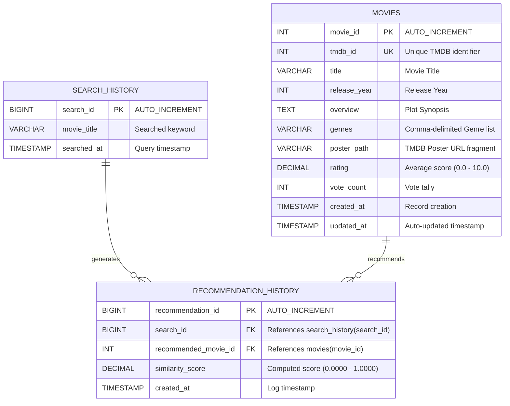
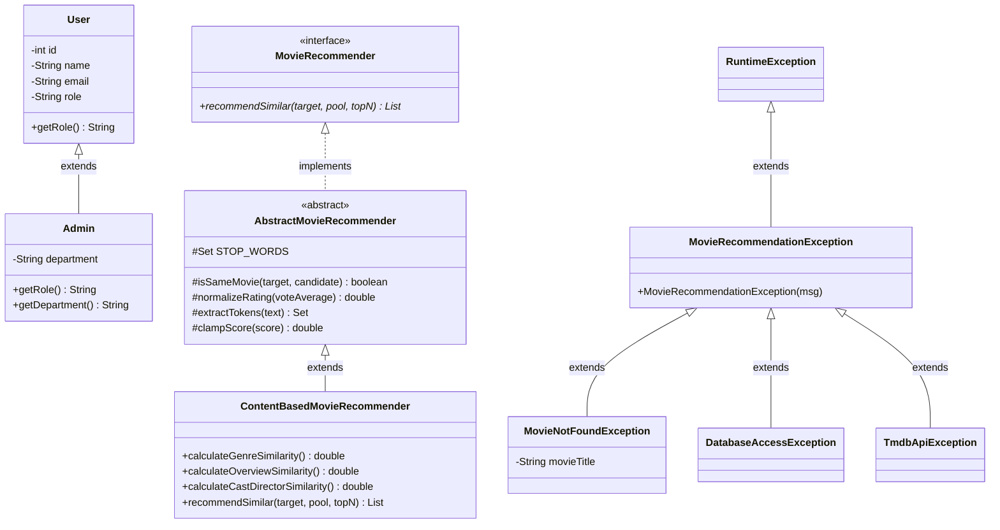

# AI-Based Movie Recommendation System

[](https://www.oracle.com/java/)
[](https://spring.io/projects/spring-boot)
[](https://www.mysql.com/)
[](#2-system-design--architecture)
[](https://maven.apache.org/)
[](#)

An enterprise-grade, content-based movie recommendation web application built from the ground up using **Java 21**, **Spring Boot 3.3.4**, **Thymeleaf**, **Vanilla CSS**, **The Movie Database (TMDB) API**, and **MySQL 8.0+ via Native JDBC**.

The system is designed with a strong focus on **Software Architecture**, **System Design Principles**, and pure **Object-Oriented Programming (OOP)** patterns. It computes multi-feature content recommendations entirely in Java using mathematical similarity algorithms (Jaccard Index, NLP Token Overlap, and Director/Cast Continuity), caches records in MySQL with atomic JDBC transactions, and provides resilient fallback mechanisms.

---

## Table of Contents

1. [Project Overview & Key Features](#1-project-overview--key-features)
2. [System Design & Architecture](#2-system-design--architecture)
   - [Architectural Layers](#21-architectural-layers)
   - [High-Level System Architecture Diagram](#22-high-level-system-architecture-diagram)
   - [End-to-End Request Lifecycle & Execution Flow](#23-end-to-end-request-lifecycle--execution-flow)
   - [Database Architecture & Entity-Relationship (ER) Diagram](#24-database-architecture--entity-relationship-er-diagram)
3. [Object-Oriented Programming (OOP) Concepts](#3-object-oriented-programming-oop-concepts)
   - [1. Encapsulation & Data Hiding](#31-encapsulation--data-hiding)
   - [2. Inheritance (IS-A Hierarchy)](#32-inheritance-is-a-hierarchy)
   - [3. Polymorphism (Dynamic Dispatch & Overriding/Overloading)](#33-polymorphism-dynamic-dispatch--overridingoverloading)
   - [4. Abstraction (Contracts & Abstract Base Classes)](#34-abstraction-contracts--abstract-base-classes)
   - [5. Composition & Association (HAS-A Relationships)](#35-composition--association-has-a-relationships)
   - [6. SOLID Principles Compliance](#36-solid-principles-compliance)
   - [7. Design Patterns Applied](#37-design-patterns-applied)
4. [How Everything is Connected](#4-how-everything-is-connected)
   - [Layer-by-Layer Interaction Pipeline](#41-layer-by-layer-interaction-pipeline)
   - [Component Interconnection Matrix](#42-component-interconnection-matrix)
   - [Multithreading & Concurrency Model](#43-multithreading--concurrency-model)
   - [JDBC Transactional Integrity (`commit` & `rollback`)](#44-jdbc-transactional-integrity-commit--rollback)
5. [Recommendation Algorithm & Mathematical Models](#5-recommendation-algorithm--mathematical-models)
   - [Scoring Formula](#51-scoring-formula)
   - [Component Breakdown](#52-component-breakdown)
   - [Business Constraints & Edge Cases](#53-business-constraints--edge-cases)
6. [Package & Directory Structure](#6-package--directory-structure)
7. [Installation, Configuration & Running](#7-installation-configuration--running)
   - [Prerequisites](#71-prerequisites)
   - [TMDB API Key Configuration](#72-tmdb-api-key-configuration)
   - [Running the Spring Boot Web Application](#73-running-the-spring-boot-web-application)
   - [Running the Academic Console Demonstration (`Main.java`)](#74-running-the-academic-console-demonstration-mainjava)
   - [Configuring Optional MySQL Persistence](#75-configuring-optional-mysql-persistence)
8. [Automated Testing Suite](#8-automated-testing-suite)

---

## 1. Project Overview & Key Features

The **AI-Based Movie Recommendation System** delivers real-time, mathematically computed movie recommendations across international and regional cinema (English, Hindi, Tamil, Telugu, Kannada, Malayalam, Korean, Japanese, Spanish, French, etc.).

### Key Highlights:
- **Zero-Dependency Quick Start**: Runs immediately out-of-the-box with an embedded H2 test database and in-memory cache, and seamlessly switches to MySQL 8.0+ when configured.
- **Pure Java Algorithmic Engine**: Similarity math is computed directly in Java without third-party black-box ML libraries, highlighting clear algorithms for academic review and code audits.
- **Live TMDB Feeds & Discovery**: Explore 5 live movie feeds: *Now Playing*, *Popular*, *Upcoming*, *Trending Today*, and *Recently Released*, complete with regional (`region=IN`) and language filtering.
- **Disambiguation Grid**: When searches return multiple adaptations, remakes, or sequels, the system displays a candidate disambiguation grid allowing users to choose the exact reference movie.
- **Explainable Recommendation Score Badges**: Displays a percentage similarity score along with an algorithm breakdown: Genre Jaccard %, Plot Semantics %, Director/Cast %, and Final Composite Score.
- **Fail-Safe Offline Mode**: Features a 40+ multi-lingual curated offline movie dataset ensuring the application functions even when disconnected from the TMDB network.

---

## 2. System Design & Architecture

### 2.1 Architectural Layers

The application adheres to the **Layered Architecture (N-Tier)** and **Model-View-Controller (MVC)** patterns. High cohesion and loose coupling are enforced across all boundaries:

```
+-----------------------------------------------------------------------+
|                         PRESENTATION LAYER                           |
|        Thymeleaf Server-Side Templates | HTML5 | CSS3 | JavaScript     |
+-----------------------------------------------------------------------+
                                   │
                                   ▼
+-----------------------------------------------------------------------+
|                         CONTROLLER LAYER                             |
|       MovieWebController (@Controller) - HTTP Routing & Model Binding  |
+-----------------------------------------------------------------------+
                                   │
                                   ▼
+-----------------------------------------------------------------------+
|                          SERVICE LAYER                                |
|   MovieRecommendationService (@Service) - Business Logic Orchestration|
|   RecommendationService (@Service)      - In-Memory User Workflows    |
+-----------------------------------------------------------------------+
         │                                            │
         ▼                                            ▼
+----------------------------------+    +-------------------------------+
|         ALGORITHM CORE           |    |     EXTERNAL INTEGRATION      |
|  MovieRecommender (Interface)    |    |  TmdbApiClient (@Component)   |
|  AbstractMovieRecommender        |    |  CompletableFuture Threads    |
|  ContentBasedMovieRecommender    |    |  In-Memory TTL Page Cache     |
+----------------------------------+    +-------------------------------+
         │                                            │
         └───────────────────────┬────────────────────┘
                                 ▼
+-----------------------------------------------------------------------+
|                    DATA ACCESS / REPOSITORY LAYER                     |
|  MovieRepository & SearchHistoryRepository (Interfaces)              |
|  MovieJdbcRepository & SearchHistoryJdbcRepository (Native JDBC)      |
|  DataRepository (In-Memory Java Collections & Generics)               |
+-----------------------------------------------------------------------+
                                 │
                                 ▼
+-----------------------------------------------------------------------+
|                        DATA PERSISTENCE TIER                          |
|         MySQL 8.0+ (InnoDB) / H2 In-Memory (Test/Fallback)            |
+-----------------------------------------------------------------------+
```

---

### 2.2 High-Level System Architecture Diagram



---

### 2.3 End-to-End Request Lifecycle & Execution Flow

The sequence below illustrates the lifecycle of a search request for `"Inception"`:



---

### 2.4 Database Architecture & Entity-Relationship (ER) Diagram

The system employs a normalized relational schema within MySQL (`movie_recommendation_db`) designed for duplicate prevention, referential integrity, and performant joining:



#### Relational Constraints & Schema Details:
1. **Foreign Keys with Cascade Actions**:
   - `fk_rec_search`: `FOREIGN KEY (search_id) REFERENCES search_history(search_id) ON DELETE CASCADE ON UPDATE CASCADE`
   - `fk_rec_movie`: `FOREIGN KEY (recommended_movie_id) REFERENCES movies(movie_id) ON DELETE CASCADE ON UPDATE CASCADE`
2. **Indexes for Accelerated Queries**:
   - `idx_movies_tmdb_id` on `movies(tmdb_id)` for $O(1)$ upsert verification.
   - `idx_movies_title` on `movies(title)` for rapid search fallback.
   - `idx_rec_search_id` on `recommendation_history(search_id)` for fast history retrieval via `INNER JOIN`.

---

## 3. Object-Oriented Programming (OOP) Concepts

The codebase is built as a reference implementation of Object-Oriented Analysis and Design (OOAD). Below is the comprehensive mapping of every OOP pillar across the project:

### 3.1 Encapsulation & Data Hiding

Encapsulation ensures an object's internal representation is hidden from the outside world and protected against invalid state transitions.

- **Private State with Controlled Accessors**:
  Every entity class (`Movie`, `Item`, `User`, `Rating`, `Category`, `MovieRecommendation`) declares all fields `private` and exposes explicit `public` getters and setters.
- **Defensive Copying in Collections**:
  In `Movie.java`, getters for collections return defensive copies (`new ArrayList<>(genres)`) or unmodifiable wrappers (`Collections.unmodifiableSet(genreSet)`), preventing external mutation of internal entity state:
  ```java
  public List<String> getGenres() {
      return new ArrayList<>(genres); // Defensive copy
  }

  public Set<String> getGenreSet() {
      return Collections.unmodifiableSet(genreSet); // Mutation prevention
  }
  ```
- **Business Rule Validation**:
  In `Rating.java`, constructor and setter methods enforce the invariant that user ratings must remain within the range $[1.0, 5.0]$, throwing an `IllegalArgumentException` on violation:
  ```java
  private void validateRating(double rating) {
      if (rating < 1.0 || rating > 5.0) {
          throw new IllegalArgumentException("Rating must be between 1.0 and 5.0.");
      }
  }
  ```

---

### 3.2 Inheritance (IS-A Hierarchy)

Inheritance enables code reusability, specialization, and behavioral extension across clean taxonomic hierarchies.



1. **Domain Model Inheritance**:
   - `Admin extends User`: `Admin` inherits common attributes (`id`, `name`, `email`, `password`) while adding `department` and overriding `getRole()`.
2. **Algorithm Engine Hierarchy**:
   - `ContentBasedMovieRecommender extends AbstractMovieRecommender`: The concrete recommender inherits reusable text tokenization, stop-word elimination, score clamping, and target movie exclusion logic from the abstract base.
3. **Custom Exception Hierarchy**:
   - All domain exceptions derive from `MovieRecommendationException` (which extends `RuntimeException`), creating a unified, structured error-handling tree (`MovieNotFoundException`, `DatabaseAccessException`, `TmdbApiException`).

---

### 3.3 Polymorphism (Dynamic Dispatch & Overriding/Overloading)

Polymorphism allows objects of different classes to respond to identical method invocations in ways specific to their implementation.

#### A. Dynamic Method Dispatch (Runtime Polymorphism):
- In `MovieRecommendationService.java`, the recommendation engine is injected via the interface `MovieRecommender`:
  ```java
  private final MovieRecommender recommender;
  // Invokes ContentBasedMovieRecommender dynamically at runtime:
  List<MovieRecommendation> recs = recommender.recommendSimilar(targetMovie, candidatePool, topN);
  ```
  If a new recommendation strategy (e.g., `CollaborativeFilteringRecommender` or `HybridRecommender`) is introduced, it can be swapped in without modifying a single line of service orchestration logic.

#### B. Method Overriding (`@Override`):
- `Admin.java` overrides `getRole()` to specialize behavior:
  ```java
  @Override
  public String getRole() {
      return "ADMIN";
  }
  ```
- `Movie.java` and `Item.java` override `equals()`, `hashCode()`, and `toString()` to guarantee correct behavior within Java Collections (`HashSet`, `HashMap`):
  ```java
  @Override
  public boolean equals(Object o) {
      if (this == o) return true;
      if (o == null || getClass() != o.getClass()) return false;
      Movie movie = (Movie) o;
      if (tmdbId > 0 && movie.tmdbId > 0) return tmdbId == movie.tmdbId;
      return releaseYear == movie.releaseYear && Objects.equals(title, movie.title);
  }
  ```

#### C. Method Overloading (Compile-Time Polymorphism):
- `ContentBasedRecommender.java` provides multiple overloaded variants of `generateRecommendations(...)`:
  - `generateRecommendations(User, List<Item>)`
  - `generateRecommendations(User, List<Item>, List<UserPreference>)`
  - `generateRecommendations(User, List<Item>, List<UserPreference>, List<Rating>)`
  - `generateRecommendations(User, List<Item>, Map<Category, Double>, Set<Integer>)`
- `Movie.java` provides multiple overloaded constructors for entity instantiation from TMDB API JSON, MySQL JDBC result sets, or minimal test harnesses.

---

### 3.4 Abstraction (Contracts & Abstract Base Classes)

Abstraction separates *what* a system component does from *how* it does it.

- **Interfaces as Pure Contracts**:
  - `MovieRecommender.java`: Declares the mathematical recommendation contract.
  - `MovieRepository.java`: Declares movie persistence operations (`saveOrUpdate`, `findByTmdbId`, `findByTitle`, `findAllCachedMovies`).
  - `SearchHistoryRepository.java`: Declares audit logging operations (`saveSearchWithRecommendations`, `findRecentSearches`, `findRecommendationsForSearchId`).
- **Abstract Classes Providing Template Functionality**:
  - `AbstractMovieRecommender.java`: Implements universal helper methods (`isSameMovie`, `normalizeRating`, `extractTokens`, `clampScore`) and holds static data (`STOP_WORDS`), leaving algorithm-specific scoring formulas to concrete subclasses.

---

### 3.5 Composition & Association (HAS-A Relationships)

Composition models strong associations between domain objects, favoring composition over deep inheritance trees:

| Host Class | Associated Class | Cardinality | Relationship Description |
| :--- | :--- | :--- | :--- |
| `Item` | `Category` | $1 \to 1$ | `Item HAS-A Category` (categorization) |
| `Rating` | `User`, `Item` | $1 \to 1$ each | `Rating HAS-A User` and `Rating HAS-A Item` |
| `MovieRecommendation` | `Movie` (target), `Movie` (candidate) | $1 \to 1$ each | Holds reference to source movie and recommendation candidate |
| `MovieRecommendationService` | `TmdbApiClient`, `MovieRecommender`, `MovieRepository`, `SearchHistoryRepository` | $1 \to 1$ each | High-level orchestrator composed of clients, engines, and repositories |
| `DataRepository` | `List<User>`, `List<Item>`, `List<Category>`, `List<Rating>` | $1 \to N$ | In-memory aggregate storage composed of generic collections |

---

### 3.6 SOLID Principles Compliance

```
+─────────────────────────────────────────────────────────────────────────────+
|                          SOLID DESIGN PRINCIPLES                            |
+─────────────────────────────────────────────────────────────────────────────+
| [S] Single Responsibility  : TmdbApiClient (HTTP/JSON), Engine (Math Sim),  |
|                              MovieJdbcRepository (SQL Execution).           |
| [O] Open / Closed          : New recommendation algorithms extend           |
|                              AbstractMovieRecommender without editing core. |
| [L] Liskov Substitution    : Admin replaces User; ContentBasedMovieRecomm-  |
|                              ender safely substitutes MovieRecommender.     |
| [I] Interface Segregation  : MovieRepository (CRUD) separated from          |
|                              SearchHistoryRepository (Audit Logs).          |
| [D] Dependency Inversion   : MovieRecommendationService depends on          |
|                              interfaces, wired via Spring DI.               |
+─────────────────────────────────────────────────────────────────────────────+
```

1. **Single Responsibility Principle (SRP)**:
   Each class has one and only one reason to change:
   - `TmdbApiClient`: Responsible solely for outbound TMDB API HTTP requests and JSON translation.
   - `ContentBasedMovieRecommender`: Responsible exclusively for calculating mathematical similarity scores.
   - `MovieJdbcRepository`: Responsible only for executing SQL statements and mapping `ResultSet` to `Movie`.
   - `MovieWebController`: Responsible solely for handling incoming HTTP requests and model binding.
2. **Open/Closed Principle (OCP)**:
   The recommendation engine is open for extension but closed for modification. If an administrator wishes to introduce collaborative filtering or hybrid scoring, they create a new class implementing `MovieRecommender` without touching existing content-based math.
3. **Liskov Substitution Principle (LSP)**:
   Any class expecting a `User` functions identically when supplied with an `Admin`. Any service dependent upon `MovieRecommender` executes seamlessly regardless of whether `ContentBasedMovieRecommender` or a mock test engine is injected.
4. **Interface Segregation Principle (ISP)**:
   Instead of a monolithic repository interface, database access is segregated into `MovieRepository` and `SearchHistoryRepository`, ensuring clients only depend on methods they actually invoke.
5. **Dependency Inversion Principle (DIP)**:
   High-level modules (e.g., `MovieRecommendationService`) do not depend on low-level concrete classes (`MovieJdbcRepository`). Both depend on abstractions (`MovieRepository`), injected at runtime via Spring Dependency Injection.

---

### 3.7 Design Patterns Applied

- **Strategy Pattern**: `MovieRecommender` serves as the strategy interface, and `ContentBasedMovieRecommender` acts as the concrete strategy.
- **Repository Pattern**: `MovieRepository` and `SearchHistoryRepository` decouple business services from database query mechanics.
- **Service Layer Pattern**: `MovieRecommendationService` coordinates complex workflows across multiple repositories and API clients.
- **Model-View-Controller (MVC)**: Clean architectural separation between models (`Movie`, `MovieRecommendation`), views (`index.html`), and controller (`MovieWebController`).
- **Data Transfer Object (DTO) / Result Wrapper**: `MovieRecommendationResult` and `MoviePageResult` bundle execution metrics, pagination metadata, and domain models for the view.
- **Graceful Degradation / Fallback Pattern**: `TmdbApiClient` encapsulates an offline curated catalog that automatically activates if network calls fail.

---

## 4. How Everything is Connected

### 4.1 Layer-by-Layer Interaction Pipeline

The end-to-end flow connects the entire stack across every layer:

```
[Browser Form Submission]
         │
         ▼
[MovieWebController] ─────────── (Receives queryTitle & optional tmdbId)
         │
         ▼
[MovieRecommendationService] ─── (Orchestrates multi-phase workflow)
         ├───────────────────────► Step 1: Query TmdbApiClient (or fallback catalog)
         ├───────────────────────► Step 2: Persist Target Movie via MovieJdbcRepository
         ├───────────────────────► Step 3: Fetch candidate pool asynchronously via TmdbApiClient
         ├───────────────────────► Step 4: Batch update candidates in MySQL
         ├───────────────────────► Step 5: Execute ContentBasedMovieRecommender (pure Java math)
         └───────────────────────► Step 6: Atomic JDBC transaction via SearchHistoryJdbcRepository
         │
         ▼
[Return MovieRecommendationResult]
         │
         ▼
[MovieWebController] ─────────── (Attaches data to Spring Model)
         │
         ▼
[Thymeleaf Template: index.html] (Renders final HTML with breakdown badges)
```

---

### 4.2 Component Interconnection Matrix

| From Component | To Component | Mechanism | Purpose |
| :--- | :--- | :--- | :--- |
| `MovieWebController` | `MovieRecommendationService` | Spring `@Autowired` Constructor Injection | Delegates movie search, candidate retrieval, and recommendation ranking |
| `MovieRecommendationService` | `TmdbApiClient` | Constructor Injection | Fetches live movie metadata, genres, overviews, and candidate pools |
| `MovieRecommendationService` | `MovieRecommender` | Interface Inversion | Invokes pure Java content-based similarity algorithm |
| `MovieRecommendationService` | `MovieRepository` | Interface Inversion | Caches movies in MySQL to prevent duplicate records (`tmdb_id UNIQUE`) |
| `MovieRecommendationService` | `SearchHistoryRepository` | Interface Inversion | Transactionally logs search queries and generated recommendation histories |
| `ContentBasedMovieRecommender`| `AbstractMovieRecommender` | Class Inheritance (`extends`) | Reuses tokenization, stop-word filtering, and target movie exclusion |
| `SearchHistoryJdbcRepository`| `DataSource` | JDBC API | Obtains native `java.sql.Connection` for transactions |
| `DataRepository` | Java Collections | Generics (`List`, `Set`, `Map`) | Provides in-memory data structures with $O(1)$ lookup complexity |

---

### 4.3 Multithreading & Concurrency Model

In `TmdbApiClient.java`, fetching candidate movies across multiple endpoints (e.g. `/movie/{id}/similar`, `/movie/top_rated`, `/discover/movie`) is executed concurrently using Java 21's `ExecutorService` and `CompletableFuture.allOf(...)`:

```java
// Thread pool dedicated to concurrent candidate gathering
private final ExecutorService executorService = Executors.newFixedThreadPool(6);

public List<Movie> fetchCandidateMoviesAsync(Movie targetMovie) {
    CompletableFuture<List<Movie>> similarFuture = 
        CompletableFuture.supplyAsync(() -> fetchSimilarFromApi(targetMovie), executorService);
    CompletableFuture<List<Movie>> topRatedFuture = 
        CompletableFuture.supplyAsync(this::fetchTopRatedFromApi, executorService);
    CompletableFuture<List<Movie>> genreFuture = 
        CompletableFuture.supplyAsync(() -> fetchByGenreFromApi(targetMovie), executorService);

    // Non-blocking parallel barrier wait
    CompletableFuture.allOf(similarFuture, topRatedFuture, genreFuture).join();
    
    // Aggregate and deduplicate candidate pool
    return mergeCandidates(similarFuture.join(), topRatedFuture.join(), genreFuture.join());
}
```

---

### 4.4 JDBC Transactional Integrity (`commit` & `rollback`)

In `SearchHistoryJdbcRepository.java`, search logging and recommendation recording are executed as an atomic database transaction. If any failure occurs, the entire transaction is rolled back:

```java
Connection conn = null;
try {
    conn = dataSource.getConnection();
    conn.setAutoCommit(false); // 1. BEGIN TRANSACTION

    // 2. Insert into search_history and retrieve generated search_id
    long searchId = insertSearchHistory(conn, movieTitle);

    // 3. Batch insert recommendations into recommendation_history
    insertRecommendationBatch(conn, searchId, recommendations);

    conn.commit(); // 4. COMMIT TRANSACTION ON SUCCESS
} catch (SQLException e) {
    if (conn != null) {
        conn.rollback(); // 5. ROLLBACK TRANSACTION ON FAILURE
    }
    throw new DatabaseAccessException("Transaction rolled back: " + e.getMessage(), e);
} finally {
    if (conn != null) {
        conn.setAutoCommit(true);
        conn.close(); // 6. CLEAN RESOURCE RELEASE
    }
}
```

---

## 5. Recommendation Algorithm & Mathematical Models

### 5.1 Scoring Formula

The engine calculates a normalized composite score for every candidate movie $B$ relative to reference movie $A$:

$$\text{FinalScore}(A, B) = \Big(0.70 \times \text{ContentSimilarity}(A, B)\Big) + \Big(0.30 \times \text{NormalizedRating}(B)\Big)$$

$$\text{ContentSimilarity}(A, B) = \Big(0.50 \times \text{GenreSim}\Big) + \Big(0.30 \times \text{OverviewSim}\Big) + \Big(0.20 \times \text{CastDirectorSim}\Big)$$

---

### 5.2 Component Breakdown

#### 1. Genre Similarity (50% of Content Score):
Uses the **Jaccard Similarity Index** on genre sets:
$$\text{GenreSim}(A, B) = \frac{|\text{Genres}_A \cap \text{Genres}_B|}{|\text{Genres}_A \cup \text{Genres}_B|}$$

#### 2. Plot Overview & Keyword Semantics (30% of Content Score):
Text is normalized (lowercased, punctuation stripped, English stop-words removed) into unique token sets, then scored using the **Overlap Coefficient**:
$$\text{OverviewSim}(A, B) = \frac{|\text{Tokens}_A \cap \text{Tokens}_B|}{\sqrt{|\text{Tokens}_A| \times |\text{Tokens}_B|}}$$

#### 3. Cast & Director Continuity (20% of Content Score):
Evaluates creative and acting overlap:
$$\text{CastDirectorSim}(A, B) = \big(\text{DirectorMatch} \ ? \ 0.60 : 0.0\big) + \left(0.40 \times \frac{|\text{Cast}_A \cap \text{Cast}_B|}{\min(|\text{Cast}_A|, |\text{Cast}_B|)}\right)$$

#### 4. Quality Rating Normalization:
$$\text{NormalizedRating}(B) = \frac{\text{voteAverage}_B}{10.0}$$

---

### 5.3 Business Constraints & Edge Cases

1. **Target Movie Exclusion**: The reference movie searched by the user is strictly excluded from recommendations ($\text{ID}_B \neq \text{ID}_A$).
2. **Deduplication**: Duplicate movies from TMDB feeds are filtered via `Set<Integer> processedMovieIds`.
3. **Dynamic Rebalancing**: If overview or cast metadata is missing for older/indie movies, weights automatically rebalance across available attributes without producing `NaN` or `DivisionByZero`.
4. **Tie-Breaking**: If two movies achieve identical `FinalScore`, they are ranked by higher quality rating, then alphabetically by title.

---

## 6. Package & Directory Structure

```
ai-recommendation-system/
├── pom.xml                                  # Maven dependencies & Java 21 build definition
├── mvnw.cmd                                 # Windows Maven Wrapper executable
├── README.md                                # Comprehensive system design documentation
├── src/
│   ├── main/
│   │   ├── java/com/recommendation/
│   │   │   ├── Main.java                    # Academic Console Demonstration entry point
│   │   │   ├── RecommendationApplication.java # Spring Boot Web Application entry point
│   │   │   │
│   │   │   ├── client/
│   │   │   │   └── TmdbApiClient.java       # TMDB API v3 HTTP client, async thread pool & fallback
│   │   │   │
│   │   │   ├── controller/
│   │   │   │   └── MovieWebController.java  # Spring MVC controller for UI routes and discovery feeds
│   │   │   │
│   │   │   ├── engine/
│   │   │   │   ├── MovieRecommender.java    # Pure interface contract for movie algorithms
│   │   │   │   ├── AbstractMovieRecommender.java # Base abstract class (tokens, stop-words, math clamping)
│   │   │   │   └── ContentBasedMovieRecommender.java # Concrete algorithm implementation
│   │   │   │
│   │   │   ├── exception/
│   │   │   │   ├── MovieRecommendationException.java # Root custom runtime exception
│   │   │   │   ├── MovieNotFoundException.java       # Thrown when movie title is not resolved
│   │   │   │   ├── DatabaseAccessException.java      # Thrown during JDBC / transaction failures
│   │   │   │   └── TmdbApiException.java             # Thrown during HTTP / API parsing errors
│   │   │   │
│   │   │   ├── model/
│   │   │   │   ├── User.java                # Base User entity demonstrating Encapsulation
│   │   │   │   ├── Admin.java               # Admin entity demonstrating Inheritance (extends User)
│   │   │   │   ├── Item.java                # Generic Item entity (Item HAS-A Category)
│   │   │   │   ├── Movie.java               # Full Movie entity with TMDB metadata & poster URLs
│   │   │   │   ├── MovieRecommendation.java # Recommendation result with breakdown metrics
│   │   │   │   ├── MoviePageResult.java     # Paginated metadata wrapper for TMDB feeds
│   │   │   │   ├── Category.java            # Genre / Category entity
│   │   │   │   ├── Rating.java              # Rating entity (Validation & Invariants)
│   │   │   │   ├── UserPreference.java      # User Category Affinity mapping
│   │   │   │   └── SearchHistory.java       # Search query audit model
│   │   │   │
│   │   │   ├── recommendation/
│   │   │   │   ├── Recommender.java         # Generic recommender interface contract
│   │   │   │   ├── RecommendationEngine.java# Abstract base recommendation engine
│   │   │   │   └── ContentBasedRecommender.java # User-preference weighted recommendation engine
│   │   │   │
│   │   │   ├── repository/
│   │   │   │   ├── MovieRepository.java     # Interface for Movie persistence operations
│   │   │   │   ├── MovieJdbcRepository.java # Native JDBC implementation with upsert queries
│   │   │   │   ├── SearchHistoryRepository.java # Interface for search/rec audit logs
│   │   │   │   ├── SearchHistoryJdbcRepository.java # Native JDBC with atomic commit/rollback
│   │   │   │   └── DatabaseInitializer.java # Auto-executes schema.sql on startup
│   │   │   │
│   │   │   └── service/
│   │   │       ├── MovieRecommendationService.java # Primary business orchestration service
│   │   │       ├── MovieRecommendationResult.java  # DTO holding search result & diagnostics
│   │   │       ├── RecommendationService.java      # In-memory preference-based service
│   │   │       └── DataRepository.java             # In-memory Java Collections & Generics engine
│   │   │
│   │   └── resources/
│   │       ├── application.properties       # Server port, datasource, and TMDB API key config
│   │       ├── schema.sql                   # MySQL 8.0+ DDL table definitions & indexes
│   │       └── templates/
│   │           └── index.html               # Responsive Thymeleaf single-page UI template
│   │
│   └── test/
│       └── java/com/recommendation/
│           ├── RecommendationApplicationTests.java # Context smoke test
│           ├── MovieRecommendationTests.java       # Comprehensive JUnit 5 algorithm tests
│           └── MovieDatabaseTests.java             # JDBC connectivity & transaction tests
```

---

## 7. Installation, Configuration & Running

### 7.1 Prerequisites
- **Java Development Kit (JDK) 21** or higher.
- **Apache Maven 3.9+** (or use the included `mvnw.cmd` wrapper).
- *(Optional)* **MySQL Server 8.0+** (if persistent relational database logging is desired).

---

### 7.2 TMDB API Key Configuration

To enable live fetching from The Movie Database, obtain a free API key or Read Access Token from [themoviedb.org](https://www.themoviedb.org/settings/api).

#### In Windows PowerShell:
```powershell
$env:TMDB_API_KEY="your_tmdb_api_key_or_token_here"
```

#### In Linux / macOS Bash:
```bash
export TMDB_API_KEY="your_tmdb_api_key_or_token_here"
```

#### In `src/main/resources/application.properties`:
```properties
tmdb.api.key=${TMDB_API_KEY:}
```
*(If no API key is provided, the application automatically operates using its curated offline multi-lingual dataset).*

---

### 7.3 Running the Spring Boot Web Application

#### Step 1: Compile and Run Tests
```powershell
.\mvnw.cmd clean test
```

#### Step 2: Start the Web Server
```powershell
.\mvnw.cmd spring-boot:run
```

#### Step 3: Open in Browser
Open your browser and navigate to:
👉 **`http://localhost:8080`**

---

### 7.4 Running the Academic Console Demonstration (`Main.java`)

To inspect the mathematical algorithm and OOP behavior directly in terminal output:

```powershell
.\mvnw.cmd compile exec:java -Dexec.mainClass="com.recommendation.Main"
```

This runs automated recommendations for *"Inception"* and *"The Godfather"*, outputting similarity score breakdowns and verifying target movie exclusion.

---

### 7.5 Configuring Optional MySQL Persistence

When you are ready to enable MySQL 8.0+ database persistence:

#### 1. Create the Database:
```sql
CREATE DATABASE IF NOT EXISTS movie_recommendation_db
    CHARACTER SET utf8mb4
    COLLATE utf8mb4_unicode_ci;
```

#### 2. Set Environment Variables in PowerShell:
```powershell
$env:SPRING_DATASOURCE_URL="jdbc:mysql://localhost:3306/movie_recommendation_db?createDatabaseIfNotExist=true&useSSL=false&allowPublicKeyRetrieval=true&serverTimezone=UTC"
$env:SPRING_DATASOURCE_USERNAME="root"
$env:SPRING_DATASOURCE_PASSWORD="your_mysql_password"
```

The application will automatically initialize `movies`, `search_history`, and `recommendation_history` tables on startup via `src/main/resources/schema.sql`.

---

## 8. Automated Testing Suite

The project includes unit and integration tests under `src/test/java/com/recommendation/`:

- **`MovieRecommendationTests.java`**:
  - Mathematical precision of Jaccard Genre similarity and NLP token overlap.
  - Strict exclusion of the target reference movie from results.
  - Verification that higher-rated candidates break similarity ties appropriately.
  - Edge cases (null/empty titles, empty candidate pools, missing metadata).
  - Custom exception handling verification (`MovieNotFoundException`).
- **`MovieDatabaseTests.java`**:
  - DataSource connectivity and connection validity.
  - CRUD operations and duplicate prevention on `movies` (`tmdb_id UNIQUE`).
  - Relational `INNER JOIN` query execution between `recommendation_history` and `movies`.
  - Transaction integrity and atomic logging.
- **`RecommendationApplicationTests.java`**:
  - Spring Boot application context load verification.

Run all tests via:
```powershell
.\mvnw.cmd test
```

---

## License & Academic Attribution
Developed as an academic and engineering reference project demonstrating **System Design**, **Clean Architecture**, **Java Collections & Generics**, **Multithreading**, **Native JDBC**, and **Object-Oriented Programming (OOP)**.
